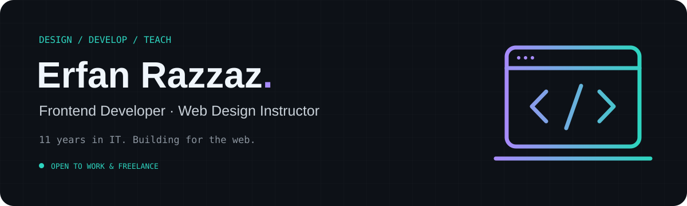
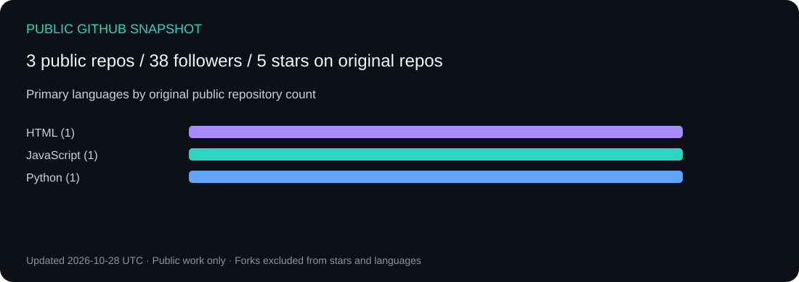

<a href="README.md">فارسی</a> · <b>English</b>

## Hi, I'm Erfan 👋

**Frontend developer and web design instructor** with around **11 years of hands-on IT experience at Rayan Technic Tehran**, spanning computer and laptop hardware, software troubleshooting, peripherals, and networking.

My current focus is designing and building web interfaces and expanding into full-stack web applications. I use AI-assisted development tools as part of my workflow.

**Open to frontend roles, freelance website projects, and web application development.**

### What I do

- Design and develop web interfaces.
- Teach web design through practical work.
- Build web applications with AI-assisted development tools.
- Bring hands-on IT troubleshooting experience to my development work.

### Selected work

Most of this work is private. The descriptions below summarize the projects and my role.

| Project | Purpose | My role |
| :--- | :--- | :--- |
| **Avan** | Student platform, available on Cafe Bazaar | Design and development contribution |
| **Rahisho** | Landing page for a robotics academy | Website design and development |
| **Fast Swap** | Landing page for a cryptocurrency trading service | Website design and development |
| **Basic Sciences Scientific Association, Sirjan University of Technology** | Association website and course registration | Website design and development |

<!-- Add Nova Mind after confirming its purpose and your role. Review individual project roles before publishing. -->

### Technologies

**Web**

**Other languages I work with**

### Let's work together

My first priority is **frontend development**, followed by **full-stack web applications**. I'm also open to freelance website projects and web design teaching opportunities.

<!-- CONTACTS: Replace the placeholders, then uncomment this section.
[LinkedIn](https://www.linkedin.com/in/YOUR_HANDLE/) · [Telegram](https://t.me/YOUR_HANDLE) · [Instagram](https://www.instagram.com/YOUR_HANDLE/) · [Website](https://YOUR_DOMAIN)
-->

### Open source & public activity

Interested in contributing to web projects and useful developer tools. These statistics cover public repositories only; they do not represent my private work or full professional experience.

<a href="https://github.com/ErfanRazzaz?tab=repositories">Explore public repositories ↗</a>

