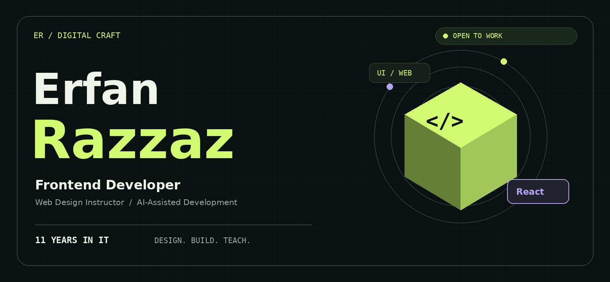
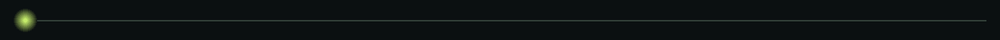
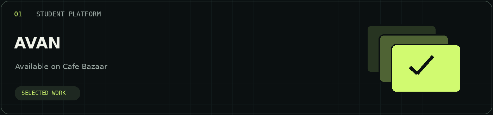
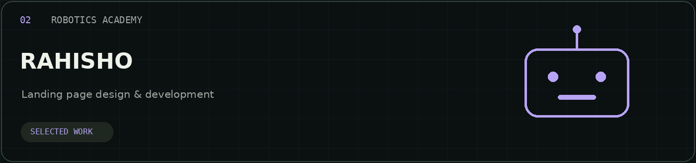
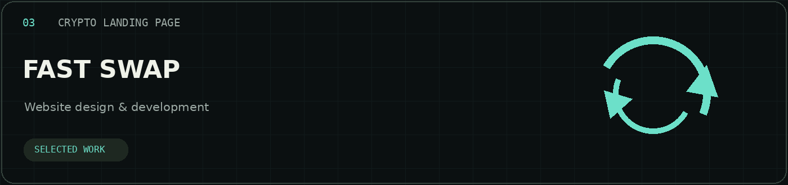
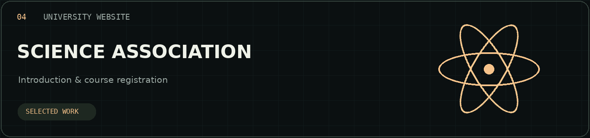
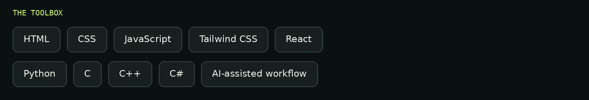
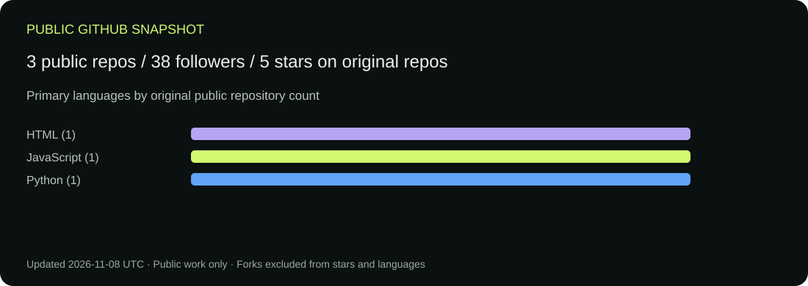
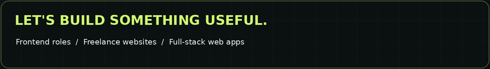

<a href="README.md">فارسی</a> &nbsp; / &nbsp; <b>English</b> &nbsp; · &nbsp; <a href="https://github.com/ErfanRazzaz?tab=repositories">Public repositories ↗</a>

## Interfaces with purpose. Experience that goes deeper.

I'm **Erfan Razzaz**, a frontend developer and web design instructor. My background includes **11 years at Rayan Technic Tehran**, working with computer and laptop hardware, software, peripherals, and networks.

Today I focus on web interfaces and expand into full-stack web applications, using AI-assisted development tools in my workflow.

**Open to frontend roles and freelance web projects.**

## 01 / Selected work

Most projects are private. The cards are custom illustrations, not product screenshots.

Avan — Student platform available on Cafe Bazaar. Design and development contribution.

Rahisho — Robotics academy landing page. Website design and development.

Fast Swap — Cryptocurrency trading landing page. Website design and development.

Basic Sciences Scientific Association, Sirjan University of Technology — Association website and course registration. Website design and development.

<!-- Nova Mind / نوا مایند: add after confirming project description and your role. -->

## 02 / Toolkit

**Web:** HTML · CSS · JavaScript · Tailwind CSS · React  
**Other languages:** Python · C · C++ · C#

## 03 / Experience & approach

- **11 years in IT · Rayan Technic Tehran:** hardware, software, peripherals, and networks.
- **Web design instructor:** teaching website design.
- **Current focus:** frontend first, then full-stack web application development.

## 04 / Public activity

Interested in contributing to useful web and open-source projects.

View public GitHub statistics

Public repositories only. Private work is not represented.

**Frontend roles · Freelance websites · Full-stack web apps**

<!-- CONTACTS: Replace YOUR_HANDLE / YOUR_DOMAIN, then uncomment these links.
[LinkedIn](https://www.linkedin.com/in/YOUR_HANDLE/) · [Telegram](https://t.me/YOUR_HANDLE) · [Instagram](https://www.instagram.com/YOUR_HANDLE/) · [Website](https://YOUR_DOMAIN)
-->

Erfan Razzaz · Design / Develop / Teach

