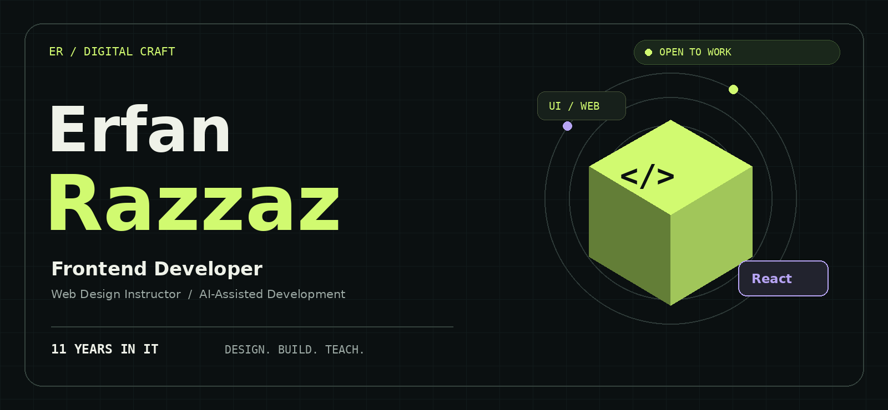
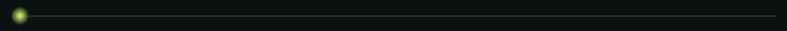
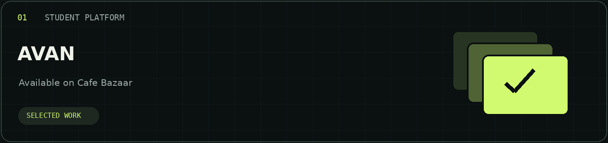
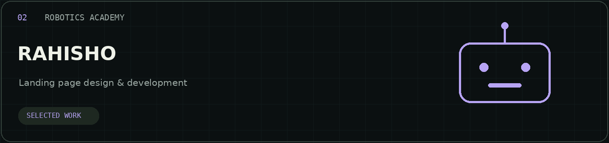
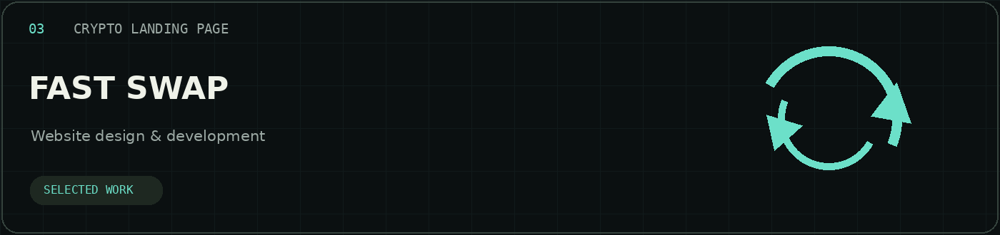
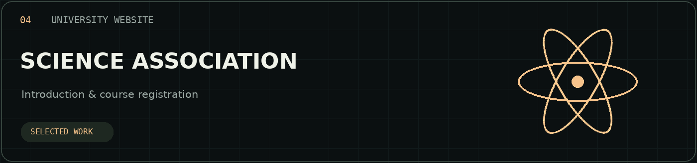
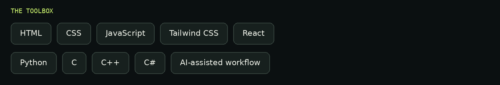
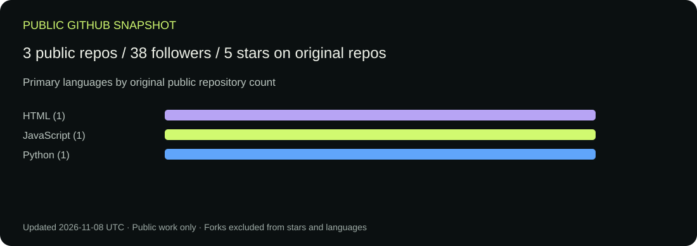
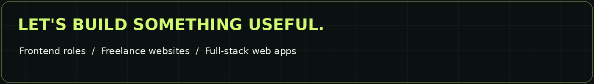

<b>فارسی</b> &nbsp; / &nbsp; <a href="README.en.md">English</a> &nbsp; · &nbsp; <a href="https://github.com/ErfanRazzaz?tab=repositories">Public repositories ↗</a>

## از تجربه فنی تا ساخت تجربه دیجیتال

من **عرفان رزاز** هستم؛ توسعه‌دهنده فرانت‌اند و مدرس طراحی سایت، با **۱۱ سال تجربه در رایان تکنیک تهران** در حوزه سخت‌افزار، نرم‌افزار، لپ‌تاپ، تجهیزات جانبی و شبکه.

امروز تمرکزم روی طراحی و برنامه‌نویسی رابط‌های وب است و با استفاده از ابزارهای هوش مصنوعی، مسیر توسعه وب‌اپلیکیشن‌های فول‌استک را هم دنبال می‌کنم.

**آماده همکاری در موقعیت‌های فرانت‌اند و پروژه‌های طراحی و توسعه وب.**

## ۰۱ / پروژه‌های منتخب

بیشتر پروژه‌ها خصوصی‌اند. تصویرهای زیر طراحی مفهومی‌اند؛ اسکرین‌شات محصول نیستند.

**آوان** — پلتفرم دانشجویی منتشرشده در کافه‌بازار. مشارکت در طراحی و برنامه‌نویسی.

**راهیشو** — لندینگ آموزشگاه رباتیک. طراحی سایت و برنامه‌نویسی.

**فست سواپ** — لندینگ خرید و فروش ارز دیجیتال. طراحی سایت و برنامه‌نویسی.

**انجمن علمی علوم پایه دانشگاه صنعتی سیرجان** — وبسایت معرفی انجمن و ثبت‌نام دوره‌ها. طراحی سایت و برنامه‌نویسی.

<!-- Nova Mind / نوا مایند: add after confirming project description and your role. -->

## ۰۲ / جعبه‌ابزار من

**وب:** HTML · CSS · JavaScript · Tailwind CSS · React  
**سایر زبان‌ها:** Python · C · C++ · C#

## ۰۳ / تجربه و مسیر حرفه‌ای

- **۱۱ سال فعالیت در رایان تکنیک تهران:** تعمیرات سخت‌افزار و نرم‌افزار، تجهیزات جانبی و شبکه.
- **تدریس طراحی سایت:** انتقال تجربه طراحی و ساخت وبسایت.
- **تمرکز فعلی:** توسعه فرانت‌اند و سپس ساخت وب‌اپلیکیشن‌های فول‌استک.

## ۰۴ / فعالیت عمومی و متن‌باز

علاقه‌مند به مشارکت در پروژه‌های کاربردی وب و متن‌باز.

مشاهده آمار عمومی گیت‌هاب / Public statistics

Public repositories only. Private work is not represented.

**همکاری در فرانت‌اند · طراحی سایت · توسعه وب‌اپلیکیشن**

<!-- CONTACTS: Replace YOUR_HANDLE / YOUR_DOMAIN, then uncomment these links.
[LinkedIn](https://www.linkedin.com/in/YOUR_HANDLE/) · [Telegram](https://t.me/YOUR_HANDLE) · [Instagram](https://www.instagram.com/YOUR_HANDLE/) · [Website](https://YOUR_DOMAIN)
-->

Erfan Razzaz · Design / Develop / Teach

